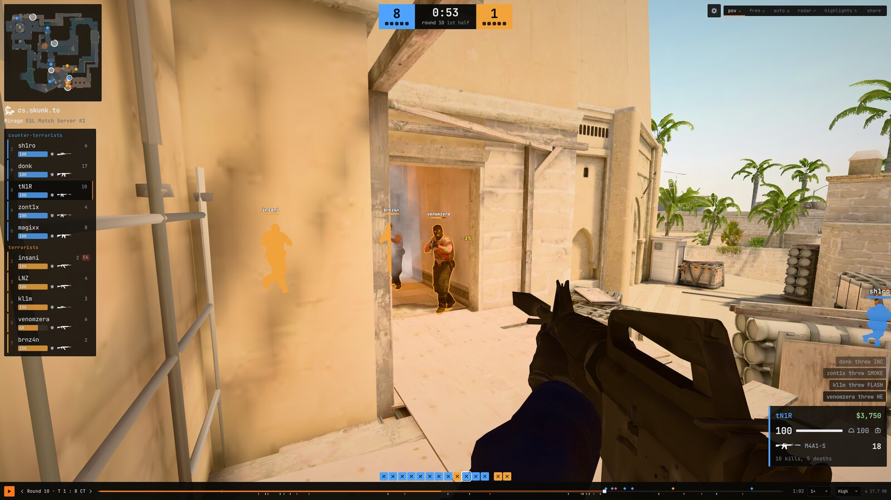
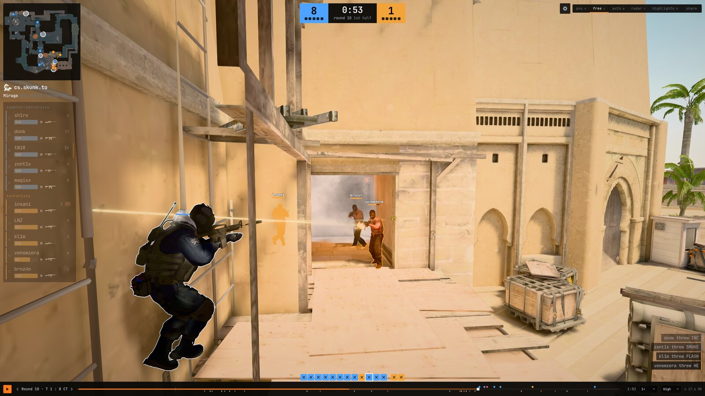
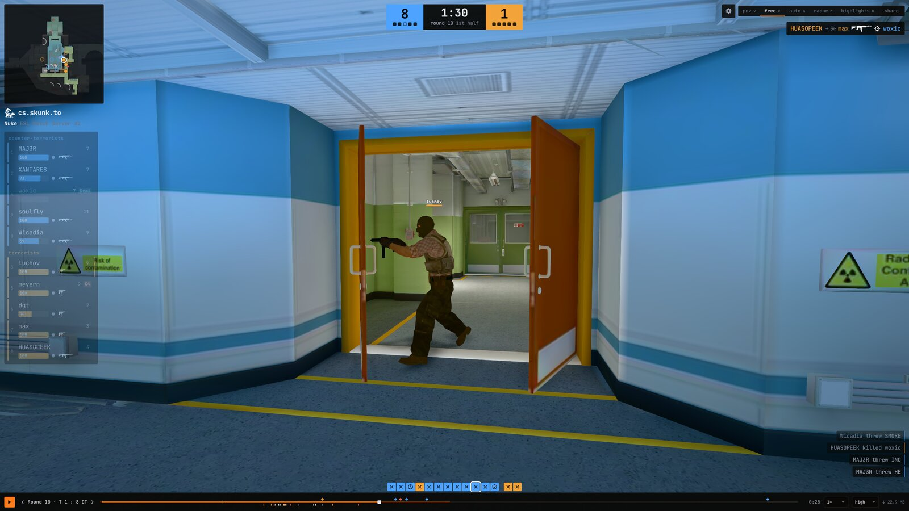
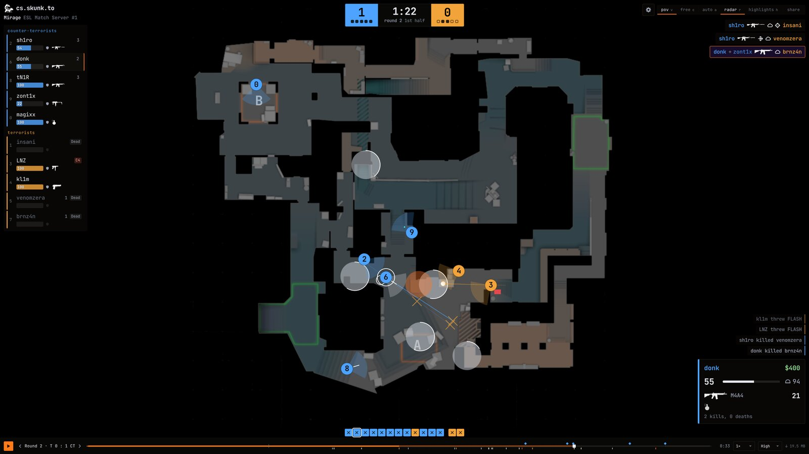

# cs2-demoviewer

Watch a CS2 match back in 3D, in your browser, on the game's own maps, with its own player
models and sounds.

### [Open the viewer: cs.skunk.to](https://cs.skunk.to)

Drop in a demo, paste a match share code or a Valve replay link, and watch.

<table>
  <tr>
    <td width="50%"><a href="docs/screenshots/first-person.jpg"></a></td>
    <td width="50%"><a href="docs/screenshots/third-person.jpg"></a></td>
  </tr>
  <tr>
    <td>First person: the player's own crosshair, arms and HUD.</td>
    <td>The free camera, on the same fight.</td>
  </tr>
  <tr>
    <td width="50%"><a href="docs/screenshots/baked-light-door.jpg"></a></td>
    <td width="50%"><a href="docs/screenshots/radar.jpg"></a></td>
  </tr>
  <tr>
    <td>Nuke under CS2's baked lighting. Doors open when they did in the match.</td>
    <td>The full radar: smokes, fires, kills, the bomb.</td>
  </tr>
</table>

The screenshots are from two IEM Cologne 2026 matches, Spirit vs MIBR on Mirage and Aurora vs
9z on Nuke, at the High preset. There is also one [on a phone](docs/screenshots/phone.jpg).

## Features

- Load a match by uploading its demo (`.dem`, `.dem.bz2` or `.dem.gz`, up to 500 MB), pasting
  its share code, or pasting its Valve replay link.
- Watch through any player's eyes: their arms and gun with CS2's viewmodel animations, their
  own crosshair (read from their settings), scopes, flashes and CS2's death view.
- Or fly a free camera anywhere. An optional director picks whose eyes to watch, cutting to a
  player just before their kill, death or plant.
- CS2's own maps, with the game's baked lighting and skies. Doors and breakable windows move
  and break when they did in the match.
- CS2's CT and T player models, with 231 animation clips each, holding the weapon they held.
- Smokes, molotovs, flashes, HEs and decoys drawn from CS2's own particle textures. Tracers,
  muzzle flashes, bullet holes, blood and the bomb.
- CS2's own sounds, placed in the world: shots, reloads, footsteps by surface, grenades, the
  bomb and the announcer.
- A HUD like the game's: kill feed, player list, player card, round bar, scoreboard (K, A, D,
  ADR, KAST, HS%, utility damage and an approximation of HLTV's Rating 2.0) and a summary after
  each round.
- Highlights (3k, 4k, ace, clutches, ninja defuses, collaterals, no-scopes, wallbangs), a reel
  that plays them back to back, and a kill cam for each death.
- A 2D radar, as a minimap or full screen. Full screen, Nuke, Vertigo and Train show both levels
  side by side.
- Play, pause, step, 0.25× to 8×, and jump between rounds. A link can open at an exact moment,
  camera and player.
- Three quality presets, picked for you from the frame rate. Phones open on the radar, and their
  3D view runs at Low with smaller textures.
- A match link pasted into Discord or a chat app shows a title and a preview card with the
  score.
- Matches aren't listed anywhere. Each one is reachable only by its link.

## What's supported

| | Supported | Not yet |
| --- | --- | --- |
| Maps | Ancient, Anubis, Cache, Dust II, Inferno, Mirage, Nuke, Overpass, Train, Vertigo | Every other map. A demo on one still opens, with the scoreboard, kill feed and rounds, but no 3D view or radar. |
| Demos | CS2 demos from Valve matchmaking and Premier (5v5). Tournament GOTV demos work too: the screenshots are from two. | Wingman, FACEIT, casual and community-server demos are untested. CS:GO demos aren't supported. |
| Getting a demo in | Uploading a `.dem`, `.dem.bz2` or `.dem.gz` file. A match share code (`CSGO-xxxxx-…`), on a server running gcbot. A Valve replay link (`http://replayN.valve.net/730/….dem.bz2`). | Links to anywhere else (FACEIT, HLTV, file hosts) are refused. Download the demo and upload it instead. |
| Desktop browsers | Chrome and other Chromium browsers. The end-to-end tests run on Chromium. | Firefox and desktop Safari aren't covered by the tests. |
| Phones | Android and iPhone, at the Low preset. The phone layout is tested in Chromium's Pixel 7 emulation, and memory was measured in WebKit's iPhone 13 emulation. | No automated tests on real phones. |

## How it works

The server takes the demo, parses it with [demoparser](https://github.com/LaihoE/demoparser) in
a child process, and writes a compact replay pack: every player's position, aim and state 32
times a second, plus the rounds, kills, grenades and doors ([format](docs/pack.md)). A 270 MB
demo of a 14-round match parses in about 2 seconds and packs to 1.8 MB. Packs are stored by the
demo's SHA-256, so the same match uploaded twice is parsed once.

The browser downloads the pack, decodes it in a Web Worker, and plays it back with three.js:
the map, the players and their weapons are GLB files, the radar is drawn on a 2D canvas, and
the sound goes through Web Audio. A Mirage match loads about 17 MB in all on a first visit.

The maps, models, textures and sounds are ripped from your own CS2 install with
Source2Viewer-CLI and shrunk to a size a browser can download.

| Path | What it is |
| --- | --- |
| [`server/`](server/README.md) | Rust (axum). Uploads, replay links and share codes in; packs, assets and the web app out. |
| [`web/`](web/README.md) | React, TypeScript and three.js. The upload page and the viewer. |
| [`tools/`](tools/README.md) | The asset pipeline: rips CS2's files and builds the `assets/` tree the server serves. |
| [`gcbot/`](gcbot/README.md) | Node, optional. Turns a share code into a replay link through Steam's Game Coordinator. |

## Run it yourself

You need Rust (through rustup: `server/rust-toolchain.toml` pins the version, and rustup
installs it on first use), Node 22 or newer, and the assets, which you build from your own copy
of CS2 (next section).

Build the web app, then start the server. It serves the app, the API and the assets on
<http://localhost:8095>:

```sh
cd web
npm ci
npm run build
cd ../server
DEMOVIEWER_ASSETS=../assets DEMOVIEWER_WEB=../web/dist cargo run --release -p demoviewer-server
```

To work on the web app with hot reload, leave the server running and run `npm run dev` in
`web/`. It serves the app on <http://localhost:5173> and passes the API and asset requests to
the server.

Or run it in Docker. The image builds the web app and the server; the assets and the data are
mounted:

```sh
docker build -t demoviewer .
mkdir -p data        # create it first: the container runs as uid 1000 and must be able to write here
docker run --rm -p 8095:8095 -v "$PWD/data:/data" -v "$PWD/assets:/assets:ro" demoviewer
```

The settings that matter most:

| Variable | Default | What it's for |
| --- | --- | --- |
| `DEMOVIEWER_PORT` | `8095` | The port to listen on. |
| `DEMOVIEWER_DATA` | `./data` | Uploads, packs and match summaries. |
| `DEMOVIEWER_ASSETS` | `./assets` | The assets you built. |
| `DEMOVIEWER_WEB` | `./static` | The built web app, `web/dist`. |
| `DEMOVIEWER_PUBLIC_URL` | unset | The address people reach the site at, for the links in preview cards. |
| `DEMOVIEWER_GCBOT_URL` | unset | gcbot's address. Unset, the server turns share codes away. |
| `DEMOVIEWER_TRUSTED_PROXIES` | `127.0.0.0/8, ::1` | Behind a reverse proxy or a tunnel, the address it connects from, so rate limits count each visitor and not the proxy. |
| `DEMOVIEWER_CACHE_BYTES` | unset | A cap on the packs kept. Unset, they are kept forever. |

The rest, the limits and the API are in [`server/README.md`](server/README.md).

### Share codes (optional)

A share code becomes a replay through gcbot, which logs in to Steam and asks Valve's Game
Coordinator for the match. It needs a Steam account that has CS2 in its library (CS2 is free).
Use a throwaway or alt account, not your main one: gcbot stays logged in and "plays" CS2 to
keep its connection, so you can't play on that account while it runs.

```sh
cd gcbot
npm ci
node src/login.mjs --state ./state          # scan the QR code with the alt's Steam app
GCBOT_STATE=./state GCBOT_HOST=127.0.0.1 npm start
```

Then start the server with `DEMOVIEWER_GCBOT_URL=http://127.0.0.1:8097`. The upload page shows
the share-code field once gcbot is connected. gcbot has no authentication, so keep it off the
internet. Valve keeps a match's replay for about a month; older codes fail. There is a
Dockerfile for it too; see [`gcbot/README.md`](gcbot/README.md).

## Rip the assets yourself

The maps, models, textures and sounds are Valve's, so they aren't in this repo. The scripts in
`tools/` build them from your own CS2 install. You need:

- Linux. The scripts are bash and take a lock with `flock` from util-linux.
- CS2, installed through Steam.
- [Source2Viewer-CLI](https://github.com/ValveResourceFormat/ValveResourceFormat/releases)
  20.1, the linux-x64 build. The current assets were built with 20.1.7467.
- Node 22 or newer.
- ffmpeg with libopus, for the sounds.
- About 30 GB of free disk.

```sh
cd tools
npm ci
cd ..
export CS2_DIR="$HOME/.local/share/Steam/steamapps/common/Counter-Strike Global Offensive"
export S2V_CLI="$HOME/.local/opt/source2viewer-cli/Source2Viewer-CLI"
tools/build-assets.sh de_mirage      # one map, plus the models, effects and sounds every map uses
tools/build-assets.sh all            # all ten maps
```

The two paths above are the defaults; set `CS2_DIR` and `S2V_CLI` only if yours are elsewhere.
Everything goes into `assets/` at the top of the repo, or wherever `ASSETS_DIR` says. Then point
the server at it with `DEMOVIEWER_ASSETS`.

How long it takes: ripping is a minute or three a map. Building all ten maps took 40 to 70
minutes on a Core i5-12600K, most of it spent shrinking the maps. One map with the rest
takes a few minutes.

Disk: `assets/raw/`, the exported files the build works from, came to 28 GB for all ten maps.
What the server serves is 1.2 GB. You can delete `assets/raw/` after a build, but the next build
then rips everything again.

The killfeed's weapon icons are drawn from the ripped weapon models, so they aren't in the repo
either: after a build, `node tools/weapon-icons.mjs` writes `web/public/weapons.png`. Without it
the killfeed, player list and player card show no weapon icons; nothing else changes.

After a CS2 update, run `tools/build-assets.sh all --force` to rip again. The full log of a
build is `assets/build.log`. [`tools/README.md`](tools/README.md) explains each step and the size
budgets the build checks.

## Tests

```sh
(cd server && cargo test --workspace --exclude parser)
(cd web && npm test && npm run lint)
(cd tools && npm test)
(cd gcbot && npm test)
```

Tests that need real demos or the built assets skip without them. Each part's README says how to
run them.

## Credits

- [demoparser](https://github.com/LaihoE/demoparser) by LaihoE (MIT) parses the demos. It is
  vendored in `server/vendor/`.
- [ValveResourceFormat](https://github.com/ValveResourceFormat/ValveResourceFormat)'s
  Source2Viewer-CLI (MIT) exports CS2's maps, models, textures and sounds.
- [three.js](https://threejs.org) draws it all, and
  [three-mesh-bvh](https://github.com/gkjohnson/three-mesh-bvh) answers the collision queries.
- [glTF Transform](https://gltf-transform.dev), [meshoptimizer](https://github.com/zeux/meshoptimizer)
  and [sharp](https://sharp.pixelplumbing.com) shrink the assets.
- [steam-user](https://github.com/DoctorMcKay/node-steam-user) and
  [globaloffensive](https://github.com/DoctorMcKay/node-globaloffensive) give gcbot its Steam and
  Game Coordinator session.
- [JetBrains Mono](https://www.jetbrains.com/lp/mono/) (SIL Open Font License 1.1) is the
  typeface.

Counter-Strike 2 and its maps, models, textures and sounds belong to Valve. This is a fan
project. It isn't affiliated with or endorsed by Valve.

## License

MIT. See [LICENSE](LICENSE). The vendored parser keeps its own MIT license, and JetBrains Mono
its OFL.
